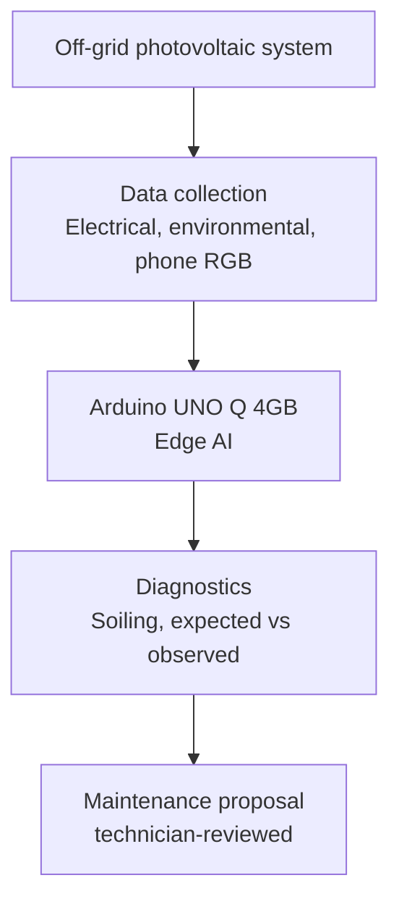
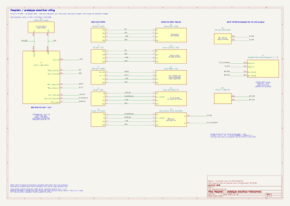

# Team response to hackTurin 2026

PoopVolt starts with the owner of an older photovoltaic plant who does not know
whether it produces as expected. A proposed expected/observed comparison makes
performance gaps visible. A photovoltaic service company uses the proposed
evidence to explain interventions the owner can understand and assess. The
three-minute story includes the approved strong opening, an MVP software case,
an STL concept, and technician-reviewed regeneration. The theoretical model,
implemented demo scope, and field benefits remain to verify. The
company-funded/free-device offer remains a secondary commercial hypothesis.

## Challenge

We are tackling the **Beyond Solar** challenge with **PoopVolt**, an Edge AI
predictive maintenance system for off-grid photovoltaic installations. See the
[project pitch](docs/pitch-draft.md) for the idea description.

## The problem and who it is for

The owner of an older photovoltaic plant usually cannot tell whether it still
produces as much as it should. Dust, bird droppings and ageing lower the output
slowly, and a plant that "apparently works" is rarely inspected. A service
company that maintains the plant has the same problem in reverse: it needs
evidence the owner can understand before proposing a cleaning, a repair or a
replacement.

## Our solution: PoopVolt

PoopVolt is a proposed Edge AI maintenance aid built around an Arduino UNO Q.
It combines three things, each kept separate and labelled by where its data
comes from (measured, replayed or simulated):

- **Expected versus observed production:** compare what a plant produced with a
  theoretical reference, and show the gap with its uncertainty. A gap is a
  candidate for inspection, not a diagnosis.
- **Visible soiling from a phone photo:** classify clean, dust or droppings on a
  panel and mark the affected region. RGB images cannot show hotspots or lost
  energy, and we make no such claim.
- **A technician-reviewed proposal:** a short evidence summary the service
  company can use to explain an intervention to the owner.

The UNO Q also reads local sensors (temperature, humidity, light, panel
current) and shows the latest findings on its LCD and as NFC tag text that a
technician's phone can read. See the [project pitch](docs/pitch-draft.md) and
the [Italian three-minute narrative](docs/pitch-narrative.md).

## How it works

Electrical, environmental and image data feed local diagnostics on the UNO Q;
maintenance and lifecycle recommendations come from those diagnostics. The
diagram shows the proposed design. Only the parts marked "working" in
[project status](docs/project-status.md) exist today.



The prototype wiring (UNO Q with Base Shield, five Grove modules and a separate
solar charging path) is recorded in [hardware connections](docs/hardware-connections.md):



More views are in the [architecture index](docs/architecture/README.md).

## What works today

| Area                                                | State              |
| --------------------------------------------------- | ------------------ |
| Grove sensors, LCD and NFC on the UNO Q             | Working (bring-up) |
| Readings streamed to the Linux side over the Bridge | Working (bring-up) |
| SOLARMA inverter log importer and replay            | Working            |
| Expected-versus-observed comparison (peers, replay) | Working (scoped)   |
| Phone RGB soiling detection                         | Not implemented    |
| Operator UI and maintenance output                  | Not implemented    |
| STL enclosure concept                               | Not delivered      |

[Project status and reuse disclosure](docs/project-status.md) has the evidence
and limits for every row, and separates what the team built from what it reuses.

## Build and run

Python (importer, replay and tests), with [uv](https://docs.astral.sh/uv/):

```bash
uv sync
uv run pytest
# Downloads the pinned SOLARMA export (needs network) and loads it
uv run python -c "from poopvolt import solarma as s; d = s.fetch('data/solarma/raw'); r = s.load_details(d / 'details.txt'); print(len(r), 'rows,', len(s.by_device(r)), 'inverters')"
```

Firmware and the bench setup: follow
[Replicate the UNO Q prototype](docs/replicate-uno-q-setup.md) (laptop tools,
wiring, flashing and checks) and [UNO Q setup](docs/uno-q-setup.md). The parts,
quantities and approximate cost are in the [bill of materials](hardware/bom.md).

## Validation

Numbers we have, with their origin:

- **Measured on the UNO Q:** CPU-only inference of reference models, for
  example NanoDet-Plus at 416x416 in 258 ms and YOLOX-S at 640x640 in 2.27 s
  ([model budget](docs/uno-q-model-budget.md)). No PoopVolt model has been run
  yet.
- **Replayed:** the SOLARMA export loads as 58,687 detail rows from 13
  inverters, with 1,157 communication outages and no irradiance values
  ([data plan](docs/data-plan.md)). One plant does not show how a model
  generalises.
- **Approximate device cost:** about 145 for the prototype, from single-unit
  list prices ([bill of materials](hardware/bom.md)). It is not a production
  cost.

- **Replayed and simulated (peer comparison):** on the SOLARMA replay, each of
  the 12 inverters with a baseline is compared with its peers; 2 are flagged as
  producing unusually little (one stopped producing in late July, one fell
  about 25 % below its peers). A **simulated** loss injected into the other
  inverters is flagged in all 10 tested cases from 8 % upwards, in 4 of 10 at
  4 to 6 %, and mostly not at 2 %. The flag threshold was chosen after seeing
  the data, so this is not an independent validation. Details, method and
  charts: [comparison results](docs/comparison-results.md).

Not yet available: soiling classifier accuracy, a weather-adjusted expected
production (the replay has no irradiance), and inference time of a PoopVolt
model on the board. They will be added here, each labelled as measured,
replayed or simulated.

## Licence and reuse

The repository is MIT licensed ([LICENSE](LICENSE)). SOLARMA data is MIT
licensed and its notice is kept in [`data/solarma/NOTICE.md`](data/solarma/NOTICE.md).
[Project status](docs/project-status.md) lists what is pre-existing.

## Repository layout

- `docs/`: architecture, pitch and reference documentation.
- `presentation/`: HTML presentation draft.
- `poopvolt/`: Python package, managed with [uv](https://docs.astral.sh/uv/).
- [firmware/](firmware/README.md): Arduino UNO Q sketches (sensor bring-up, NFC station).
- [hardware/](hardware/README.md): available parts and substitutions, KiCad
  schematic; 3D-printable parts are planned.
- `data/`: measurements and fixtures; SOLARMA replay notice in `data/solarma/`.
- `tests/`: Python tests, run with `uv run pytest`.

Set up the Python environment with `uv sync`.

## Quick links

- [Three-minute Italian narrative](docs/pitch-narrative.md) — owner, production
  comparison, software demo, STL concept, and regeneration.
- [Project pitch](docs/pitch-draft.md) — proposed product and commercial
  context.
- [Expected versus observed on the SOLARMA replay](docs/comparison-results.md)
  — peer comparison, results and charts (replayed and simulated).
- [Data and demonstration plan](docs/data-plan.md) — phone-camera simulation and
  separate historical SOLARMA replay.
- [Hardware availability](docs/hardware.md) — secured prototype parts and phone
  RGB camera replacement for the unavailable thermal camera.
- [Project status and reuse disclosure](docs/project-status.md) — what works,
  what is incomplete, what we built and what we reuse.
- [HTML presentation draft](presentation/README.md) — architecture, narrative,
  and implementation plan.
- [Presentation guidelines](.agent/README.md) — contributor and agent guidance.
- [Architecture index](docs/architecture/README.md) — diagram hierarchy and
  system design.
- [Coesa Energy evaluator context](docs/company/coesa-energy.md) — researched
  company background, sources, and PoopVolt fit hypotheses for contributors and
  AI models.

- [Documentation reference index](docs/references.md) — official sources and
  retrieval keywords for contributors and AI agents.
- [hackTurin Manuale dei partecipanti](https://docs.google.com/document/u/0/d/1Amd6yVSujHK4o_KcjB97IKTJN76TH6P6QJ-XG2Q1pEk/mobilebasic)
- Dropbox share:
  [hackturin-2026](https://www.dropbox.com/scl/fo/5eclqx2zvtit1mjfkiske/AGWotLCqgu1aaEHfJxRGDaE?rlkey=ni635441clcv6t9ir6xaxde1j&st=n5uyvz8e&dl=0)
- <https://kiro.dev/>

## The Team

- [Giacomo Lisita](https://www.linkedin.com/in/giacomolisita) | GitHub:
  <https://github.com/giacolees> | Telegram: @younglees
- [Gianpaolo Macario](https://www.linkedin.com/in/gmacario/) | GitHub:
  <https://github.com/gmacario> | Telegram: @gmacario
- [Lorenzo Palloni](https://www.linkedin.com/in/lorenzopalloni/) | GitHub:
  <https://github.com/lorenzopalloni> | Telegram: @lorenzopalloni
- [Federico Nebuloni](https://www.linkedin.com/in/federico-nebuloni-770641246) |
  GitHub: <https://github.com/fedenebu> | Telegram: @Foxtrot230

## hackTurin 2026 at a glance

### Events on Luma

- [hackTurin - kickoff](https://luma.com/q34azfxn?tk=ttfAQz)
- [hackTurin](https://luma.com/t2odor1k?tk=Sw9Jz9)
- [hackTurin - premiazione](https://luma.com/gwgj3w45?tk=Np7Euc)

### Presenters during Kickoff

- [Marco Gay](https://www.linkedin.com/in/marcogay) - CEO, Zest. Ex Presidente
  Giovani Imprenditori di Confindustria
- [Federico Sandrone](https://www.linkedin.com/in/federico-sandrone) - CEO,
  Coesa Energy. Presidente Gruppo Giovani Imprenditori di Torino
- ...

### Confirmed Mentors

- [Davide Gomba](https://www.linkedin.com/in/davidegomba) - Seeed Studio
- [Luciano Lavagno](https://www.linkedin.com/in/luciano-lavagno-487495) -
  Politecnico di Torino
- [Andrea Richetta](https://www.linkedin.com/in/andrearichetta) - Arduino
- [Matteo Stoppa](https://www.linkedin.com/in/matteo-stoppa) - Coesa Energy

## Partners and Sponsors

- [Amazon Web Services (AWS)](https://aws.amazon.com)
- [Apeira](https://www.apeira.it/)
- [Arduino](https://www.arduino.cc/)
- [Club TOsto](https://www.clubtosto.com/)
- [COESA Energy](https://landing.coesaenergy.it)
- [GOMA Elettronica](https://www.goma.it)
- [Seeed Studio](https://www.seeedstudio.com)
- Unione Industriali Torino - Gruppo Giovani Imprenditori

### Useful links

- <https://fuorielettrico.vercel.app/>
- <https://www.solarma.it/impianto.html>
- <https://www.solarma.it/servizi.html#progettazione>

<!-- EOF -->
