# Application Architecture

- Diagram ID: `pv-architecture`
- Level: Architecture
- Status: Proposed draft; interfaces, models, and platform unimplemented.
- Parent: [Parent view](context.md)

## Diagram

```mermaid
flowchart LR
    phone["Phone RGB capture / single-string demo"]
    inputs["Inverter, logger or sensors / SOLARMA replay"]
    subgraph edge["Customer-site PoopVolt edge application"]
        acquisition["Acquisition"]
        diagnostics["Diagnostics"]
        maintenance["Maintenance"]
        storage[("Local storage")]
        interface["Operator interface / local view"]
        sync["Synchronization / queued exchange"]
    end
    subgraph company["Proposed company service platform"]
        portfolio["Plant registry and portfolio findings"]
        review["Operator interface / company and customer views"]
    end
    phone -->|Frames and declared plant/string mapping| acquisition
    inputs -->|Telemetry and source identity| acquisition
    acquisition -->|Quality-checked scoped observations| diagnostics
    acquisition -->|Observations and mapping| storage
    storage -->|History and topology| diagnostics
    diagnostics -->|Findings, localization scope and uncertainty| maintenance
    diagnostics -->|Finding records and evidence| storage
    storage -->|Interventions and cost assumptions| maintenance
    maintenance -->|Recommendations and economic review inputs| interface
    maintenance -->|Recommendation and scenario records| storage
    interface -->|Reviewed actions and outcomes| storage
    storage -->|Queued findings, summaries and actions| sync
    sync -->|Exchange when connected| portfolio
    portfolio -->|Evidence, freshness and coverage| review
    review -->|Reviewed interventions and configuration| sync
    sync -->|Received records| storage
```

## Explanation

Acquisition, Diagnostics, and Maintenance remain logical modules on the edge.
`Local storage` is inside that boundary. The Operator interface has proposed
local, company, and customer views; its framework is undecided.

The [secured hardware](../hardware.md) supplies the UNO Q 4GB with Media Carrier,
Base Shield, environmental/current sensors, and LCD for integration work. The
phone RGB camera replaces the unavailable thermal camera. Thermal acquisition
and thermal inference are deferred and are not part of the current input path.

The company platform supplies portfolio access and service review. Owners see
their own plant, while company operators see assigned plants. Identity, access
control, transport, retention, and integrations must be selected before a pilot.
No existing Coesa API is assumed.

Synchronization buffers outgoing records, preserves observation time separately
from upload time, and needs duplicate handling and intervention reconciliation.
Offline analysis continues; a remote view shows the age of its last update.
Raw imagery stays local by default; any upload policy is an open decision.

Findings carry plant, inverter/channel, optional mapped string/panel, source type,
evidence references, quality, and localization scope. A phone scene and historical
replay cannot be fused as simultaneous evidence from one plant. See the
[data plan](../data-plan.md) for the proposed observation contract.

## Related Views

[Acquisition](components/acquisition.md) · [Diagnostics](components/diagnostics.md) ·
[Maintenance](components/maintenance.md) · [Deployment](deployment.md) ·
[Architecture index](README.md)
