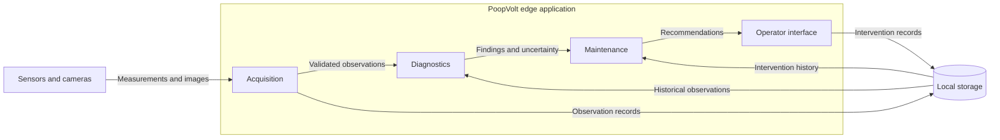

# Application Architecture

- Diagram ID: `pv-architecture`
- Level: Architecture
- Status: Proposed draft; implementation and hardware choices are unverified.
- Parent: [Parent view](context.md)

## Diagram

## Explanation

Acquisition, Diagnostics, and Maintenance are logical modules within a proposed edge application, not confirmed independent services. The `Local storage` component preserves observations and intervention history. The Operator interface exposes recommendations; its technology is undecided.

## Related Views

[Acquisition](components/acquisition.md) · [Diagnostics](components/diagnostics.md) · [Maintenance](components/maintenance.md) · [Deployment](deployment.md) · [Architecture index](README.md)
