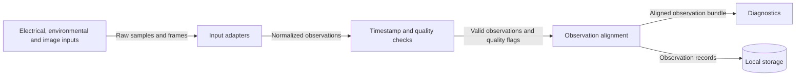

# Acquisition Components

- Diagram ID: `pv-acquisition`
- Level: Components
- Status: Proposed draft; implementation and hardware choices are unverified.
- Parent: [Parent view](../architecture.md)

## Diagram

## Explanation

Input adapters normalize source measurements. Quality checks identify missing, stale, or invalid inputs. Alignment associates measurements and frames in time before Diagnostics consumes them. Sample rates, units, timestamp tolerance, retention, and degraded-input behavior remain open decisions.

## Related Views

[Diagnostics](diagnostics.md) · [Deployment](../deployment.md) · [Architecture index](../README.md)
