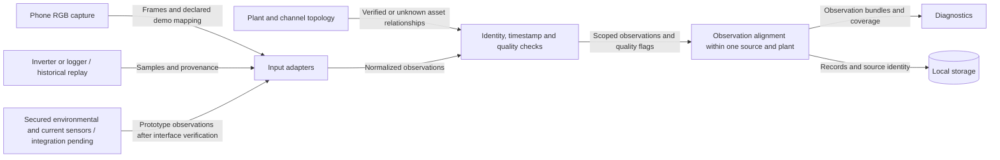

# Acquisition Components

- Diagram ID: `pv-acquisition`
- Level: Components
- Status: Proposed draft; adapters and observation contracts unimplemented.
- Parent: [Parent view](../architecture.md)

## Diagram

## Explanation

Adapters handle phone images, historical SOLARMA exports, and future verified
field telemetry. Preserve units, source identity, original observation time,
ingestion time, and whether data are simulated, replayed, or measured in the field.
Missing values remain missing rather than becoming zeros.

The [hardware inventory](../../hardware.md) identifies AHT20 temperature/humidity,
relative light, and ACS70331 current inputs to integrate. None supplies thermal
images, a verified irradiance baseline, or current-and-voltage power measurements.
The phone RGB camera is the current camera input; thermal acquisition is deferred.

Mapping associates an inverter/channel or image region with a plant and, only
where established, a string/panel. A declared demo mapping is not a surveyed
installation map. Unknown relationships limit localization to the known scope.
Coverage reports expose missing, stale, or unmapped channels.

Alignment combines observations only from the same plant and compatible times.
The phone simulation and historical SOLARMA plant are separate scenarios.
Sample rates, timezone interpretation, timestamp tolerance, image transfer,
field protocols, and retention remain decisions to verify.

## Related Views

[Data plan](../../data-plan.md) · [Diagnostics](diagnostics.md) ·
[Deployment](../deployment.md) · [Architecture index](../README.md)
