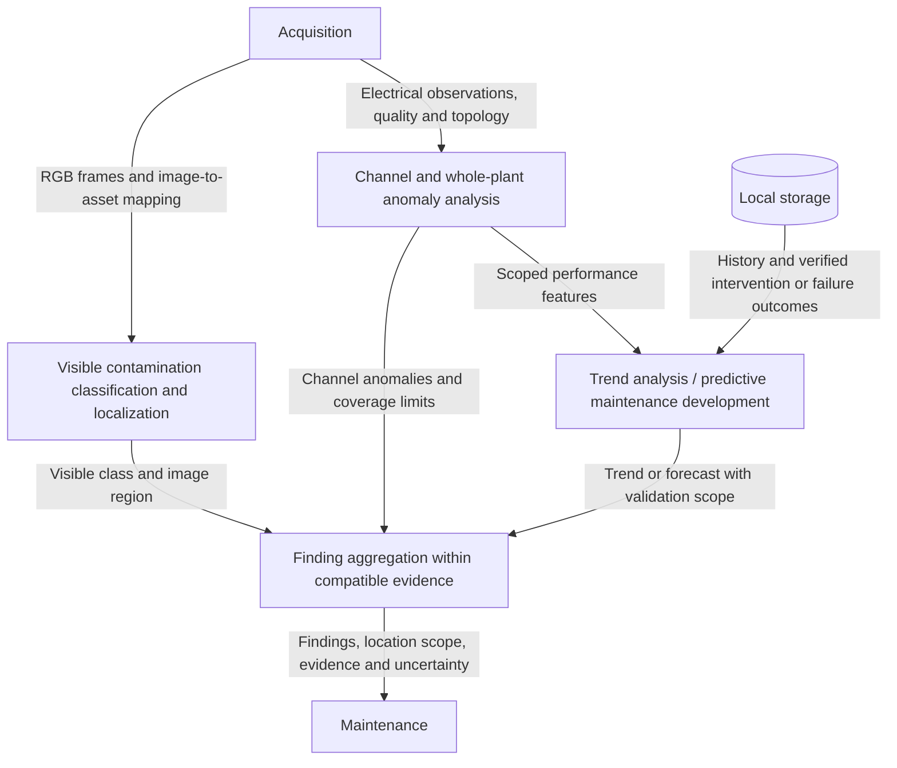

# Diagnostics Components

- Diagram ID: `pv-diagnostics`
- Level: Components
- Status: Proposed draft; no trained model or evaluation is established.
- Parent: [Parent view](../architecture.md)

## Diagram

## Explanation

For one mapped string, RGB analysis targets visible clean, dust-like,
droppings-like, mixed, or unknown observations and deposit regions. Final classes
and model selection depend on collected labels. A region identifies visible
contamination, not a measured open circuit or hotspot. Physical localization
depends on a verified image-to-panel/string map.

For multiple channels, electrical analysis targets persistent deviations against
a historical baseline and compatible peers. Inverter inputs may contain multiple
strings. Unequal capacities, orientation, shade, weather, operating state, and
logger outages can explain differences. Aggregate power cannot localize a module.

Edge ML for anomaly/trend detection is proposed. A current anomaly is not a
validated future-failure forecast. Predictive maintenance needs representative
longitudinal data, labeled outcomes, a warning horizon, and held-out evaluation.
Degradation estimation requires sufficient history and an environmental baseline;
the inspected SOLARMA export lacks populated irradiance values.

Finding aggregation preserves provenance and does not fuse the unrelated phone
demo and SOLARMA replay. The [Grove thermal camera is unavailable](../../hardware.md),
so thermal analysis is deferred and the current diagram omits that branch.
The selected phone RGB camera supports visible contamination analysis; RGB
soiling alone supports at most a hotspot-risk inspection request. AHT20 ambient
temperature cannot confirm a panel hotspot.
Unsupported classification or mapping yields unknown/review-required.
Models, thresholds, calibration, edge resource budgets, and metrics remain open.

## Related Views

[Data plan](../../data-plan.md) · [Maintenance](maintenance.md) ·
[Soiling flow](../flows/detect-soiling.md) ·
[Whole-plant flow](../flows/monitor-plant.md) · [Architecture index](../README.md)
