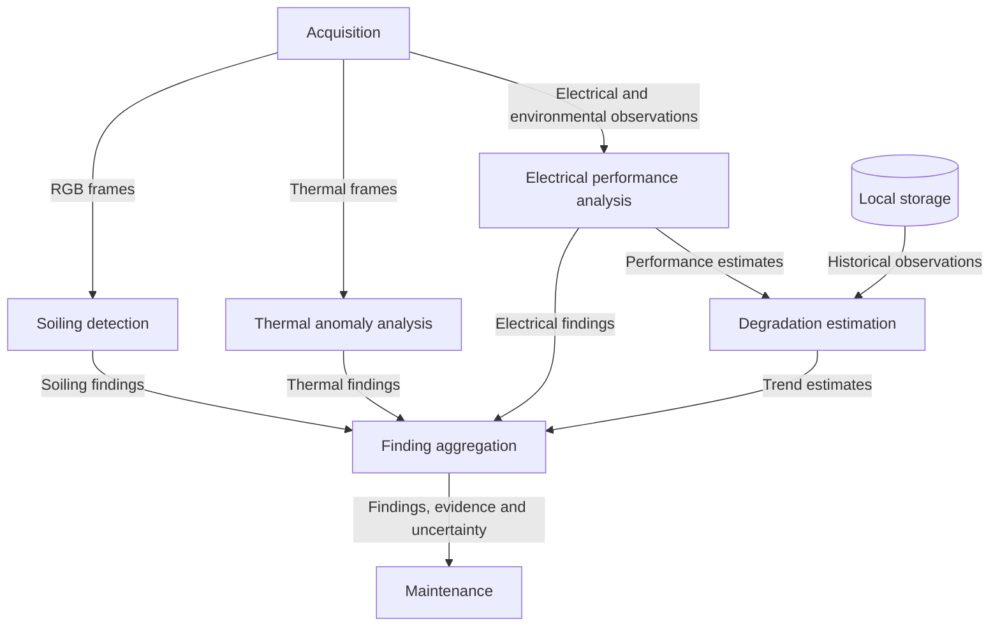

# Diagnostics Components

- Diagram ID: `pv-diagnostics`
- Level: Components
- Status: Proposed draft; implementation and hardware choices are unverified.
- Parent: [Parent view](../architecture.md)

## Diagram

## Explanation

Diagnostics combines image findings with electrical performance and historical trends. Degradation estimation requires sufficient history and an environmental baseline; a single image does not establish irreversible degradation. Model choices, calibration, fusion logic, thresholds, and evaluation metrics are not yet selected.

## Related Views

[Datasets](../../references.md#datasets) · [Maintenance](maintenance.md) · [Soiling detection flow](../flows/detect-soiling.md) · [Architecture index](../README.md)
