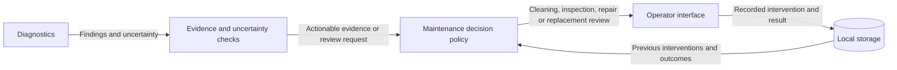

# Maintenance Components

- Diagram ID: `pv-maintenance`
- Level: Components
- Status: Proposed draft; implementation and hardware choices are unverified.
- Parent: [Parent view](../architecture.md)

## Diagram

## Explanation

Maintenance converts findings into operator recommendations. Evidence checks should request inspection when confidence is insufficient. Revamping avoidance means recommending proportionate interventions based on evidence; replacement decisions require an operator review. Forecasting methods and battery-aware scheduling remain future design work.

## Related Views

[Maintenance recommendation flow](../flows/recommend-maintenance.md) · [Diagnostics](diagnostics.md) · [Architecture index](../README.md)
