# Maintenance Components

- Diagram ID: `pv-maintenance`
- Level: Components
- Status: Proposed draft; policies and economic estimates unvalidated.
- Parent: [Parent view](../architecture.md)

## Diagram

```mermaid
flowchart LR
    diagnostics["Diagnostics"]
    evidence["Evidence, scope and uncertainty checks"]
    history[("Local storage")]
    policy["Maintenance decision policy"]
    economics["Intervention and revamping scenario assessment"]
    interface["Operator interface"]
    diagnostics -->|Findings with provenance and coverage| evidence
    evidence -->|Actionable finding or inspection request| policy
    history -->|Interventions, baseline and cost assumptions| policy
    policy -->|Cleaning, inspection, repair or revamping review| economics
    economics -->|Recommendation and qualified economic scenarios| interface
    interface -->|Reviewed action, owner acceptance and outcome| history
```

## Explanation

Maintenance converts findings into a company technician's review, a customer
proposal, and a recorded intervention. Insufficient evidence requests inspection
or another observation. The policy compares continued operation, cleaning,
targeted repair, and revamping. Revamping is a potentially useful service when
evidence supports it; avoiding replacement is not the overriding objective.

A visible deposit may justify cleaning review, but does not establish recovered
energy. Persistent electrical underperformance after cleaning can motivate
further inspection; it does not by itself establish irreversible degradation.

## Proposed economic review

Compare every option against the same continued-operation baseline and horizon.
Show input source, date, units, uncertainty, and missing inputs. A scenario needs
measured production history, a defensible expected-production baseline, a
technical estimate of recoverable yield, an intervention quote, and the owner's
energy-use/export assumptions. These inputs are not supplied by the phone demo.

Conceptually, annual incremental energy value is additional self-consumed kWh
times avoided purchase cost plus additional exported kWh times export value.
Annual net benefit deducts incremental operating costs. A simple payback estimate
uses upfront intervention cost divided by positive annual net benefit; where
benefit is nonpositive or inputs are missing, show no supported payback estimate.
Revamping reviews also need downtime, useful-life horizon, and sensitivity to
production and energy value. No numeric profitability claim is established here.

The company's offer has its own economics: incremental service margin and any
agreed platform revenue must cover device acquisition, installation, connectivity,
support, and operation. Free distribution is a commercial hypothesis to validate,
not zero-cost deployment or proven customer conversion.

The technician reviews the evidence; the owner accepts a quoted intervention.
Later observations assess the result against comparable conditions without
assuming success. Scheduling and forecast methods remain future design work.

## Related Views

[Maintenance flow](../flows/recommend-maintenance.md) ·
[Diagnostics](diagnostics.md) · [Project pitch](../../pitch-draft.md) ·
[Architecture index](../README.md)
