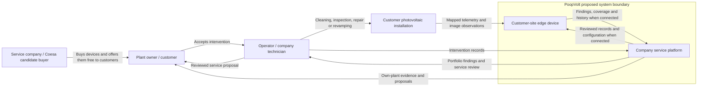

# System Context

- Diagram ID: `pv-context`
- Level: System context
- Status: Proposed draft; product, integration, and business model unverified.
- Parent: [Parent view](overview.md)

## Diagram

## Explanation

The company is the buyer and service provider; the owner receives the device
under the proposed free-device offer. Technicians review findings and owners
accept service work. This is a proposed distribution model, not a Coesa agreement.

Local diagnostics work without continuous connectivity. Remote portfolio review
requires synchronization and displays last-seen time and channel coverage.
The platform is part of the proposed product boundary, with technology and
integration still undecided. Grid-connected systems are in scope; off-grid and
second-life systems are potential extensions.

## Related Views

[Architecture](architecture.md) · [Deployment](deployment.md) ·
[Company context](../company/coesa-energy.md) · [Architecture index](README.md)
