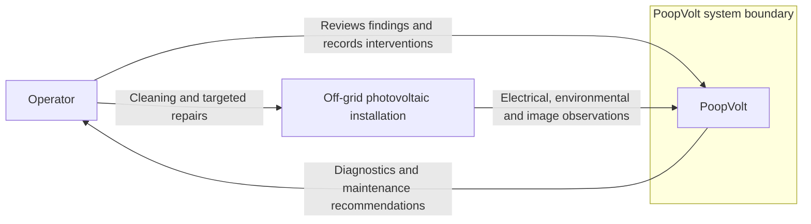

# System Context

- Diagram ID: `pv-context`
- Level: System context
- Status: Proposed draft; implementation and hardware choices are unverified.
- Parent: [Parent view](overview.md)

## Diagram

## Explanation

PoopVolt observes the installation and advises an operator. Physical maintenance remains an operator action in this draft. Continuous cloud connectivity is not required; cloud services are not part of the proposed core boundary.

## Related Views

[Architecture](architecture.md) · [Deployment](deployment.md) · [Architecture index](README.md)
