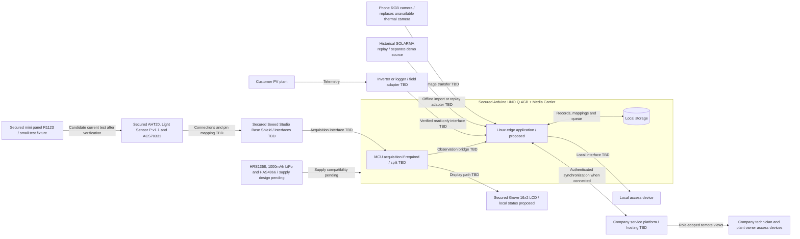

# Physical Deployment

- Diagram ID: `pv-deployment`
- Level: Deployment
- Status: Proposed integration; secured hardware is recorded, interfaces unverified.
- Parent: [Parent view](architecture.md)

## Diagram

## Explanation

The UNO Q 4GB with Media Carrier is secured for proposed local inference and
history analysis. The selected phone RGB camera replaces the unavailable Grove
thermal camera. Phone transfer is unverified; no permanent phone installation or
thermal acquisition is in the current prototype scope. Historical replay is
imported independently of the phone scene.

The [hardware inventory](../hardware.md) records all secured and missing items.
The Seeed Studio Base Shield is selected instead of the Grove shield v2. Sensor
and LCD paths are logical integration intentions, not verified wiring. No
breadboards are available; cables, adapters, and pin mapping still need checking.

HRS1358 replaces the unavailable Waveshare charger as the charging candidate.
The battery, mini panel, and step-down converter are secured components, not an
assembled or validated supply. The diagram does not establish their wiring order
or sufficient power for the UNO Q. AHT20/light readings supply context, and the
current sensor targets a compatible small test circuit. These are not thermal
imaging or full-plant instrumentation.

A field device needs verified logger compatibility or instrumentation for each
claimed channel. One inverter input can represent several parallel strings;
channel topology must be verified before promising string-level coverage.
Exact module location needs a surveyed image-to-panel/string mapping or additional
measurements. Device count and electrical interfaces depend on plant topology.

Power supply, enclosure, network provisioning, MCU/Linux split, resource budget,
and installation cost remain open. Battery-aware operation is only relevant to
future off-grid deployments. No arrows specify wiring or voltage compatibility.

The [prototype electrical wiring](../hardware-connections.md) records the
USB-powered assembly reported in PR #49, including selected Grove interfaces.
It does not establish the battery/solar supply or the full deployment above.

## Related Views

[UNO Q references](../references.md) · [Data plan](../data-plan.md) ·
[Hardware inventory](../hardware.md) · [Acquisition](components/acquisition.md) ·
[Architecture index](README.md)
