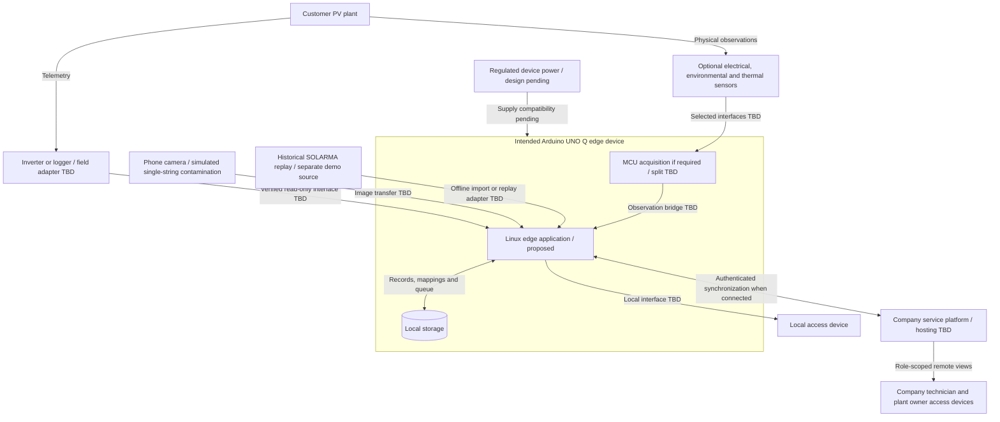

# Physical Deployment

- Diagram ID: `pv-deployment`
- Level: Deployment
- Status: Proposed draft; hardware and transport require verification.
- Parent: [Parent view](architecture.md)

## Diagram

## Explanation

The intended UNO Q runs local inference and history analysis. A phone supplies
RGB frames for the hackathon; no permanent phone installation or thermal camera
is assumed. Historical replay is imported independently of the phone scene.

A field device needs verified logger compatibility or instrumentation for each
claimed channel. One inverter input can represent several parallel strings;
channel topology must be verified before promising string-level coverage.
Exact module location needs a surveyed image-to-panel/string mapping or additional
measurements. Device count and electrical interfaces depend on plant topology.

Power supply, enclosure, network provisioning, MCU/Linux split, resource budget,
and installation cost remain open. Battery-aware operation is only relevant to
future off-grid deployments. No arrows specify wiring or voltage compatibility.

## Related Views

[UNO Q references](../references.md) · [Data plan](../data-plan.md) ·
[Acquisition](components/acquisition.md) · [Architecture index](README.md)
