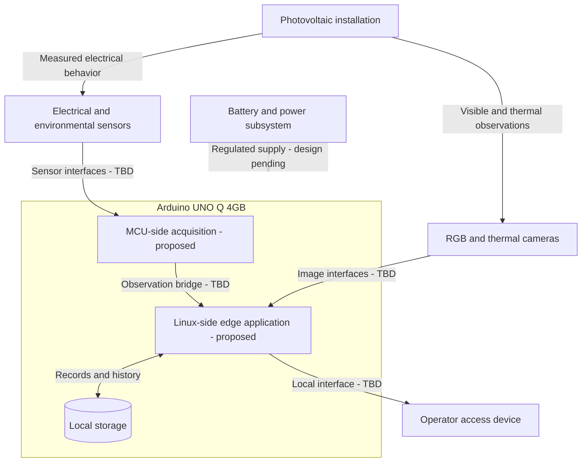

# Physical Deployment

- Diagram ID: `pv-deployment`
- Level: Deployment
- Status: Proposed draft; implementation and hardware choices are unverified.
- Parent: [Parent view](architecture.md)

## Diagram

## Explanation

The UNO Q is the intended edge platform. The MCU/Linux responsibility split, sensor and camera connections, regulated power supply, storage medium, and operator access method need hardware verification. Arrows show intended connections and do not specify wiring or voltage compatibility.

The [prototype electrical wiring](../hardware-connections.md) records the
USB-powered assembly reported in PR #49, including selected Grove interfaces.
It does not establish the battery/solar supply or the full deployment above.

## Related Views

[UNO Q references](../references.md) · [Acquisition](components/acquisition.md) · [Architecture index](README.md)
