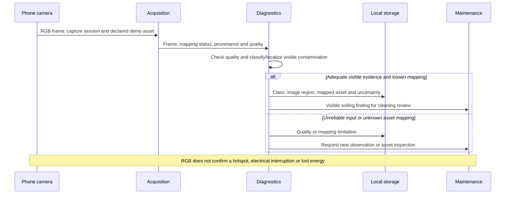

# Soiling Detection Flow

- Diagram ID: `pv-flow-soiling`
- Level: Runtime flow
- Status: Proposed draft; phone capture and inference unimplemented.
- Parent: [Parent view](../components/diagnostics.md)

## Diagram

## Explanation

The phone demonstration targets a visible region on a declared panel/string
with simulated dust or droppings. Known mapping means known for that setup;
field mapping needs separate verification. Usable images with unknown mapping
can still support image-region findings, but not a claimed physical string.
Unreliable observations lead to review rather than unsupported classification.

## Related Views

[Data plan](../../data-plan.md) · [Acquisition](../components/acquisition.md) ·
[Maintenance flow](recommend-maintenance.md) · [Architecture index](../README.md)
