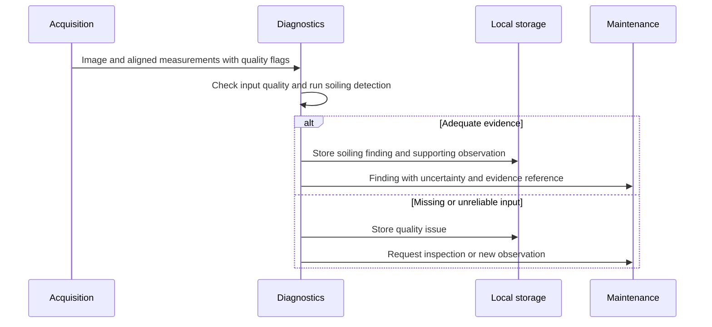

# Soiling Detection Flow

- Diagram ID: `pv-flow-soiling`
- Level: Runtime flow
- Status: Proposed draft; implementation and hardware choices are unverified.
- Parent: [Parent view](../components/diagnostics.md)

## Diagram

## Explanation

A proposed soiling inference begins with quality-checked observations. Diagnostics preserves evidence and communicates uncertainty. An unreliable observation leads to a review request rather than an unsupported contamination finding.

## Related Views

[Acquisition](../components/acquisition.md) · [Maintenance recommendation](recommend-maintenance.md) · [Architecture index](../README.md)
