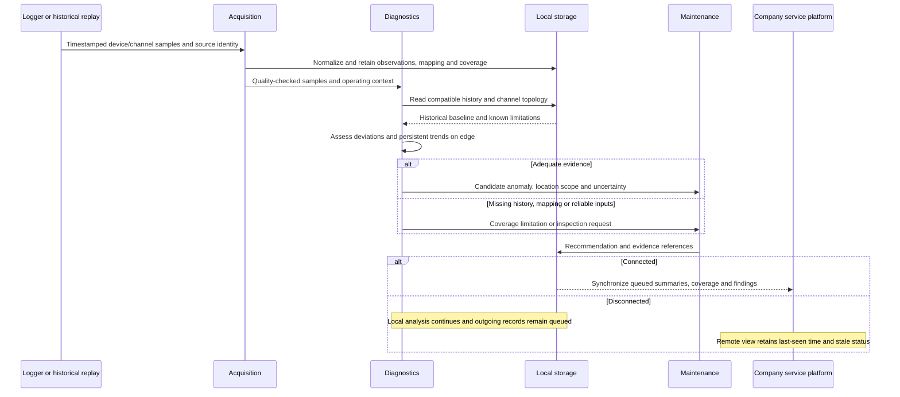

# Whole-Plant Monitoring Flow

- Diagram ID: `pv-flow-plant`
- Level: Runtime flow
- Status: Proposed draft; replay, model, and synchronization unimplemented.
- Parent: [Parent view](../components/diagnostics.md)

## Diagram

## Explanation

Historical replay retains its original timestamps and a replay label. It is
independent of the phone scene. Field ingestion would use a verified adapter.
An anomaly's scope cannot exceed the known plant/channel/string mapping.
This flow demonstrates the proposed path toward predictive maintenance; a
current deviation is not proof that a future failure has been predicted.

## Related Views

[Data plan](../../data-plan.md) · [Diagnostics](../components/diagnostics.md) ·
[Maintenance flow](recommend-maintenance.md) · [Architecture index](../README.md)
