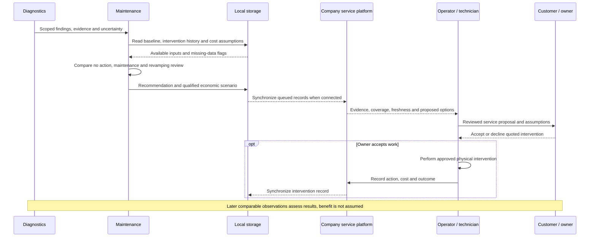

# Maintenance Recommendation Flow

- Diagram ID: `pv-flow-maintenance`
- Level: Runtime flow
- Status: Proposed draft; service and economic review unimplemented.
- Parent: [Parent view](../components/maintenance.md)

## Diagram

## Explanation

The company reviews evidence before offering cleaning, inspection, repair, or
revamping. The owner accepts service work. Economic scenarios need explicit
inputs and cannot be derived from a visible deposit alone. Local operator review
remains available offline; remote company and customer views require connection
and expose record freshness. This draft automates no physical intervention.

## Related Views

[Soiling flow](detect-soiling.md) · [Whole-plant flow](monitor-plant.md) ·
[System context](../context.md) · [Architecture index](../README.md)
