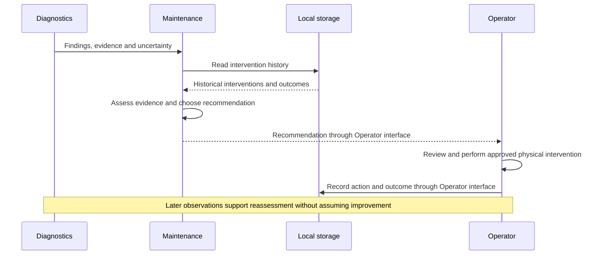

# Maintenance Recommendation Flow

- Diagram ID: `pv-flow-maintenance`
- Level: Runtime flow
- Status: Proposed draft; implementation and hardware choices are unverified.
- Parent: [Parent view](../components/maintenance.md)

## Diagram

## Explanation

The operator reviews a recommendation before physical maintenance. Recorded actions and later observations support reassessment. This draft does not automate cleaning, switching, or component replacement.

## Related Views

[Soiling detection](detect-soiling.md) · [System context](../context.md) · [Architecture index](../README.md)
