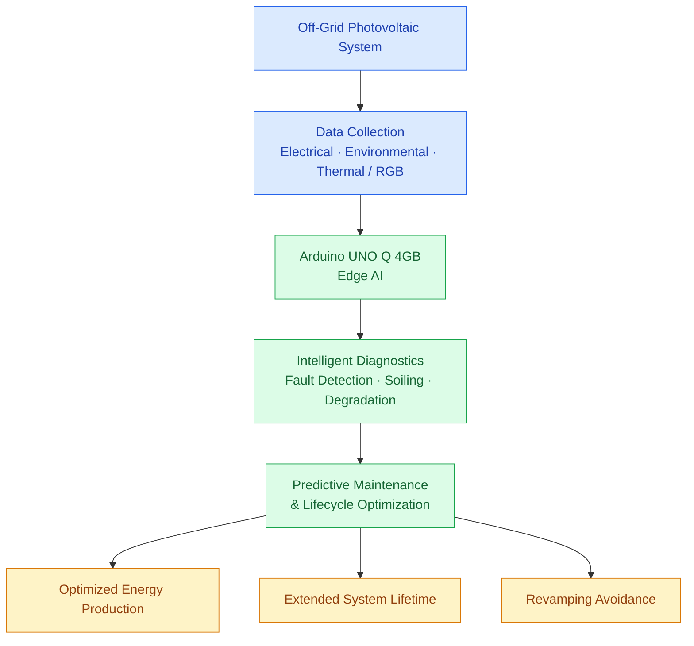

# System Overview

- Diagram ID: `pv-overview`
- Level: Overview
- Status: Proposed draft; implementation and hardware choices are unverified.
- Parent: [Parent view](README.md)

## Diagram

## Explanation

Electrical, environmental, and image measurements feed local Edge AI diagnostics. Maintenance and lifecycle recommendations aim to improve energy availability and avoid unnecessary replacement. These outcomes are goals, not measured results.

## Related Views

[System context](context.md) · [Project pitch](../pitch-draft.md) · [Architecture index](README.md)
