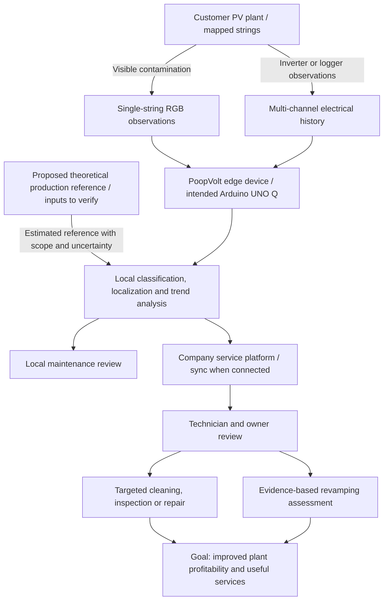

# System Overview

- Diagram ID: `pv-overview`
- Level: Overview
- Status: Proposed draft; outcomes and implementation unverified.
- Parent: [Parent view](README.md)

## Diagram

## Explanation

The owner narrative starts from uncertain plant performance. A proposed
theoretical reference and observed production support scoped deviation review,
subject to input quality and verified mapping. This comparison alone does not
identify the cause or guarantee recoverable energy.

The commercial hypothesis sells an edge device to a service company, which can
distribute it free to its customers. One observation path targets visible
contamination on a mapped string; another targets whole-plant underperformance
using multi-channel history. Both support a service decision. Predictive
maintenance is a development goal, requiring longitudinal validation beyond
detecting a current anomaly.

The phone-camera demo and SOLARMA replay are independent evidence paths. Neither
establishes complete plant coverage, confirmed hotspots, or economic returns.
The [data plan](../data-plan.md) defines their limits.

## Related Views

[System context](context.md) · [Project pitch](../pitch-draft.md) ·
[Architecture index](README.md)
