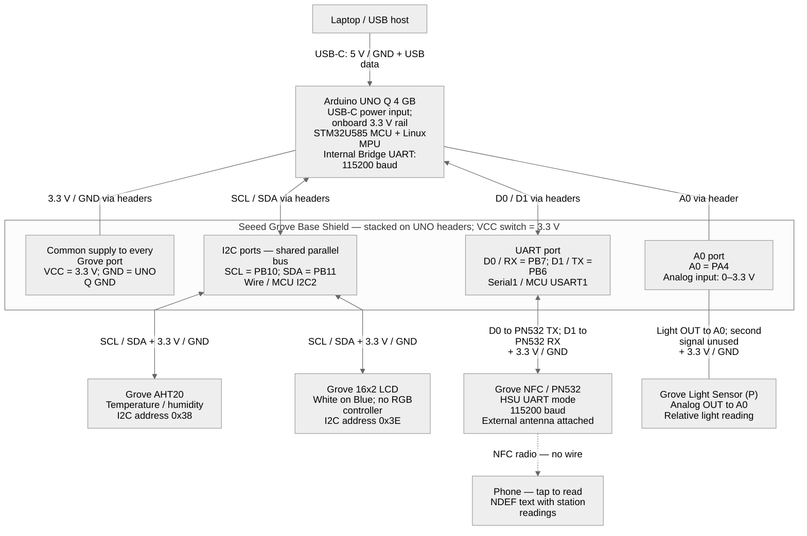

# Hardware connections (as built, 2026-10-10)

- Diagram ID: `pv-wiring`
- Level: Electrical wiring / prototype deployment
- Status: Implemented prototype, as reported by the bring-up author in
  [PR #49](https://github.com/B-AROL-O/hackturin-2026/pull/49); not independently
  retested for this diagram.
- Parent: [Physical deployment](architecture/deployment.md)
- Scope: USB-powered UNO Q, Base Shield, and the four connected Grove modules.

The connection record in PR #49 reports verification with
[`sensor_diag`](../firmware/sensor_diag/sensor_diag.ino) and
[`station`](../firmware/station/station.ino). The team photo supplied on
2026-10-10 shows the assembly and a loose current sensor. Pin assignments and
the shield voltage setting below come from the bring-up record, since they
cannot all be read from the photo.

## Electrical wiring diagram

[Open the rendered SVG](architecture/diagrams/pv-wiring.svg).

Each module connection represents one four-conductor Grove cable, not a single
wire. The common supply node describes the power pins in those same cables;
there are no separate power jumpers. Solid lines are wired connections; arrows
show signal direction, not current direction. The dashed line is the station's
NFC interface. The internal Bridge is on the UNO Q and does not use D0/D1.

## Grove cable pinout

<!-- markdownlint-disable MD013 -->

| Cable conductor | I2C: AHT20 and LCD         | UART: PN532                   | Analog: light sensor              |
| --------------- | -------------------------- | ----------------------------- | --------------------------------- |
| Pin 1, yellow   | PB10 / SCL to module SCL   | PB7 / D0 / MCU RX to PN532 TX | Module OUT to PA4 / A0            |
| Pin 2, white    | PB11 / SDA to module SDA   | PB6 / D1 / MCU TX to PN532 RX | Shield A1; unused by light sensor |
| Pin 3, red      | Shield 3.3 V to module VCC | Shield 3.3 V to module VCC    | Shield 3.3 V to module VCC        |
| Pin 4, black    | Common GND                 | Common GND                    | Common GND                        |

<!-- markdownlint-enable MD013 -->

Pin numbers follow the [Seeed Grove connector convention](https://wiki.seeedstudio.com/Grove_System/#interface-of-grove-modules),
not a left-to-right view of a connector. The UART labels are from the host's
point of view: the standard cable connects MCU RX to module TX and MCU TX to
module RX; no extra crossed jumper wiring is required.
The MCU header mapping is documented in the
[official UNO Q pinout](https://docs.arduino.cc/resources/pinouts/ABX00162-full-pinout.pdf).

## Main board

- **Arduino UNO Q (4 GB)** has two processors:
  - Linux MPU (Qualcomm QRB2210, Debian)
  - MCU (STM32U585, Zephyr, runs the sketches)
- The MPU and MCU are linked internally by UART at 115200 baud (MCU `LPUART1` ↔ Linux `/dev/ttyHS1`). This is the "Bridge", on the board, with no external wiring.
- **USB-C** connects to the laptop and provides 5 V power, ADB, and USB serial (`/dev/ttyACM0`).

## Seeed Grove Base Shield

Stacked on the UNO Q's UNO-format headers. **VCC switch set to 3.3 V**, so every Grove port supplies 3.3 V and GND.

| Shield port | UNO Q signal (MCU pin)                                      | Device                                             | Bus / address   | Status   |
| ----------- | ----------------------------------------------------------- | -------------------------------------------------- | --------------- | -------- |
| I2C         | SDA (PB11), SCL (PB10): MCU I2C2, `Wire`                    | Grove AHT20 temperature/humidity                   | I2C 0x38        | verified |
| I2C         | same bus                                                    | Grove 16x2 LCD (monochrome, no RGB backlight chip) | I2C 0x3E        | verified |
| UART        | D0 = MCU RX (PB7), D1 = MCU TX (PB6): MCU USART1, `Serial1` | Grove NFC (PN532), HSU mode, 115200 baud           | UART            | verified |
| A0          | A0 (PA4), ADC1 ch 9                                         | Grove light sensor (phototransistor)               | analog, 0–3.3 V | verified |

Notes:

- The shield's I2C ports are wired in parallel, so it doesn't matter which I2C port each device uses.
- On the UART link, the PN532's TX goes to D0 (MCU RX) and its RX to D1 (MCU TX), using a standard Grove cable.
- The PN532 doesn't respond on I2C. That's expected, because it is in UART (HSU) mode.

## Not currently connected

- Grove 2.5A DC Current Sensor (ACS70331): loose in the photo; no Grove cable or measured-current circuit connected. No current or voltage acquisition is shown in this diagram.
- Arduino Modulino Movement (LSM6DSOX, I2C 0x6A): connects to the UNO Q's Qwiic connector (MCU `Wire1`). It was used for the first bring-up and is unplugged now.
- Arduino Media Carrier: not used.
- Camera (planned): an Android phone streaming over Wi-Fi to the Linux side. Wireless, no wiring.
- Solar panel, charger, LiPo battery, and step-down converter: inventory items, not part of the USB-powered wiring recorded in PR #49. Their power path remains unverified.

## Diagram maintenance

The Mermaid block above is the canonical source for `pv-wiring`. Regenerate
`docs/architecture/diagrams/pv-wiring.svg` from that block when connections change; do not
edit the export independently. The export uses Mermaid CLI 11.4.2 with native
SVG text and `xml:space="preserve"` on the SVG root to retain spaces between
words in image viewers. Keep this as-built snapshot separate from the
proposed full-system deployment, which includes future power and camera paths.

See the [architecture index](architecture/README.md).
