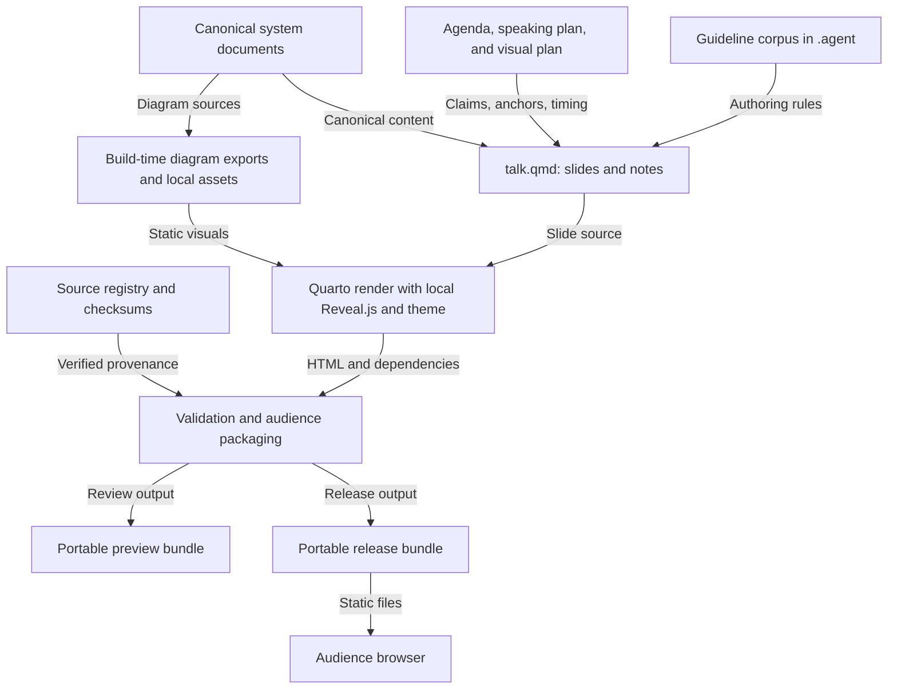

# HTML presentation architecture

- Architecture ID: `pv-presentation`
- Status: Proposed draft, with no runtime implementation yet.
- System source: [PoopVolt architecture index](../docs/architecture/README.md).
- Build sequence: [Implementation plan](plan/implementation.md).

## Purpose and boundaries

Explain how observations become an evidence-based maintenance recommendation
for an off-grid photovoltaic operator. Give judges a readable pitch and engineers
a technical appendix, using the same sources and stable diagram identities.

The presentation is a static site. It shows architectural proposals and an
optional illustrative decision scenario. It does not acquire telemetry, execute
inference, trigger maintenance, or establish the Operator interface technology.
The site runs on an audience browser independently of the intended UNO Q system.

## Existing architecture translated into presentation work

<!-- markdownlint-disable MD013 -->

| Canonical area  | Audience explanation                                            | Presentation work                                 | Product work still unresolved                             |
| --------------- | --------------------------------------------------------------- | ------------------------------------------------- | --------------------------------------------------------- |
| Context         | The operator reviews recommendations and performs physical work | Operator/installations relationship visual        | Local operator access method                              |
| Acquisition     | Observations need timestamps and quality checks                 | Quality annotations and missing-input scenario    | Sensors, adapters, units, rates, alignment tolerance      |
| Diagnostics     | Each modality supplies different evidence                       | RGB, thermal, electrical, and history explanation | Models, calibration, fusion, thresholds, evaluation       |
| Maintenance     | Evidence supports a proportionate recommendation                | Illustrated finding and review sequence           | Decision policy, forecasting, battery-aware scheduling    |
| `Local storage` | History supports reassessment after an intervention             | History loop and evidence links                   | Retention, storage medium, record contracts               |
| Deployment      | Local processing targets the intended UNO Q platform            | Proposed deployment view in appendix              | Power, compatibility, MCU/Linux bridge, camera interfaces |

<!-- markdownlint-enable MD013 -->

Source pages remain authoritative. Presentation excerpts must carry the parent
diagram ID and proposed status. Keep wiring details and unsupported hardware
specifications out of the main deck.

## Stack decision

Propose Quarto with Reveal.js, following the reference's authoring workflow.
Markdown keeps slides and speaker notes reviewable. Reveal.js supplies navigation,
overview, deep links, and presentation controls. SCSS defines an original theme.
Small JavaScript enhancements handle motion preferences and the optional scenario.

Use build-time rendering for canonical Mermaid diagrams so the audience bundle
contains static, accessible figures. Pin tool versions after validating the first
render. The initial build needs no Node application framework or backend.

Technical references:
[Quarto Reveal.js](https://quarto.org/docs/presentations/revealjs/),
[presenting and exporting](https://quarto.org/docs/presentations/revealjs/presenting.html),
and [diagram authoring](https://quarto.org/docs/authoring/diagrams.html).
Offline behavior, print completeness, and responsive reading are acceptance
requirements to verify, not guarantees from choosing the stack.

## Build and runtime boundaries



This diagram describes the proposed presentation build, not the PoopVolt edge
application. Preview and release use the same inputs, with separate output paths.
The audience browser loads local assets and optional illustrative fixture data.

## Target file layout

Only documentation and the source manifest exist in this draft. All runtime and
build files below are planned. Generated directories must be ignored when added.

```text
.agent/
  README.md                  guideline entry point
  content.md                 narrative and evidence rules
  visual-design.md           original design direction
  interaction.md             navigation, scenario, motion, accessibility
  workflow.md                build and contributor workflow
  validation.md              review and acceptance criteria
presentation/
  README.md
  architecture.md
  plan/
    agenda.md
    speech_plan.md
    plots_plan.md
    implementation.md
  sources/
    README.md
    manifest.json            canonical source revision and checksum registry
  talk.qmd                   PLANNED: single canonical slide source
  _quarto.yml                PLANNED: rendering and presenter/audience profiles
  theme.scss                 PLANNED: tokens, layouts, print, reading mode
  fonts.css                  PLANNED: local font declarations
  assets/                    PLANNED: images, fonts, licenses, provenance
  figures/                   PLANNED: generated canonical diagram exports
  data/scenarios.json        PLANNED: explicitly illustrative scenario fixture
  js/presentation.js         PLANNED: motion preference and lifecycle handling
  js/scenario.js             PLANNED: optional local scenario enhancement
  scripts/render_diagrams.py PLANNED: extract canonical Mermaid and render it
  scripts/check_presentation.py PLANNED: source, timing, links, bundle checks
  scripts/build_share.py     PLANNED: portable bundle and local references
  preview/                   PLANNED: ignored review output
  deployment/                PLANNED: ignored release output
```

## Responsibility contracts

<!-- markdownlint-disable MD013 -->

| Module               | Inputs                                            | Outputs and limits                                    |
| -------------------- | ------------------------------------------------- | ----------------------------------------------------- |
| Narrative source     | Plan, canonical docs, source IDs                  | Slides, notes, stable anchors, timing metadata        |
| Diagram generation   | Canonical page, Mermaid block, diagram ID         | Static figure, description, parent ID, source hash    |
| Theme                | Design tokens and layout classes                  | Screen, print, and narrow-width styles                |
| Motion enhancement   | Active slide, preference, visibility, print state | Optional motion with a complete static fallback       |
| Scenario enhancement | Local fixture and explicit selection              | Coupled observation/finding/recommendation view       |
| Source checker       | Manifest, slide source, plans, assets             | Errors for mismatched claims, inputs, or dependencies |
| Packaging            | Validated render, local assets, source documents  | Audience bundle with working relative references      |

<!-- markdownlint-enable MD013 -->

Keep all required static slide content in `talk.qmd`. JavaScript must not be the
only place where the main claim, uncertainty, or source attribution exists.
An interactive scenario enriches a complete static default, rather than gating it.

## Proposed presentation metadata

Each future main slide has a stable ID from the agenda, an integer duration in
seconds, source IDs, and claim status. Store these as Quarto heading attributes
and validate the rendered metadata as well as the authored source.
The nine-slide total is 300 seconds. Appendix IDs start with `pv-a-` and are
excluded from the main timing and counter.

The source manifest records repository-relative paths, baseline revision,
SHA-256, scope, and upstream URL. It is a registry of canonical files, not a
second copy of the system architecture. At build time, fail on a checksum mismatch
until the source change has been reviewed and the baseline deliberately refreshed.

## Illustrative scenario contract

The proposed fixture schema is presentation-only. It is not an edge API contract.

<!-- markdownlint-disable MD013 -->

| Field            | Meaning                                                      |
| ---------------- | ------------------------------------------------------------ |
| `id`             | Stable scenario ID                                           |
| `status`         | Always `illustrative` for the initial fixture                |
| `sourceIds`      | Canonical design sources that justify the depicted behavior  |
| `observations`   | Modality, readable summary, timestamp context, quality flag  |
| `finding`        | Kind, evidence references, uncertainty explanation           |
| `recommendation` | Suggested action, reason, and `operatorReviewRequired: true` |
| `limitations`    | Missing inputs and unverified assumptions                    |

<!-- markdownlint-enable MD013 -->

Case one has adequate illustrative soiling evidence and a cleaning review.
Case two has stale or missing imagery and requests inspection or a new observation.
Display uncertainty in words. Do not insert invented probabilities or electrical
thresholds. Do not infer irreversible degradation from either case.

## Delivery model and open decisions

Package local scripts, fonts, figures, fixture data, and readable source references
with the generated `index.html`. Serve the portable folder over HTTP. Strip private
notes in the audience profile and verify their absence from the bundle. A presenter
profile retains notes for local rehearsal. Print includes complete static content.

The draft leaves the host, public path, official pitch duration, final slide
language, actual image assets, exact tool versions, and font acquisition open.
The defaults above allow drafting without making those choices into product facts.
Review them before implementation or publication. A host connection is unnecessary
to build and evaluate the local presentation.
